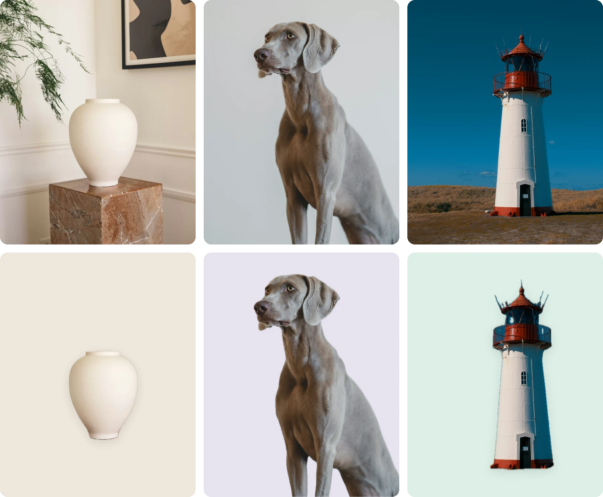

# loupe

Cut out subjects, read text and scan QR codes and barcodes in images and PDFs, from the command line.

loupe uses the Vision framework that ships with macOS, the same models behind Live Text and "Copy Subject" in Photos. It works offline, it is free, and your files never leave your Mac.



<sub>Top: the original photos. Bottom: `loupe cutout`, placed on a plain colour. Photos by [Mathilde Langevin](https://unsplash.com/photos/WUrXahlyjBo), [Cristofer Maximilian](https://unsplash.com/photos/5_nJw3UUgpQ) and [Phil S](https://unsplash.com/photos/GD-TykjO8K4) on Unsplash.</sub>

```console
$ loupe cutout vase.jpg
vase-cutout.png

$ loupe text receipt.pdf
Harbour Street Bakery
2 x Sourdough loaf 9.00
1 x Oat flat white 4.20

$ loupe codes menu.png
WIFI:S:Harbour Guest;T:WPA;P:sourdough42;;
```

## Why

Removing a background or copying the text out of a scanned PDF usually means uploading the file to a website, or opening an app and clicking through it one file at a time. macOS already has good on-device models for both, but no command to reach them from a terminal or a script. loupe is that command, so a folder of product photos or a stack of scanned invoices is one line of shell.

## Install

loupe needs macOS 14 Sonoma or later.

On Apple silicon, with [Homebrew](https://brew.sh):

```sh
brew install firatgezer/tap/loupe
```

On Intel Macs, or to build it yourself, with Xcode or the Command Line Tools installed:

```sh
git clone https://github.com/firatgezer/loupe.git
cd loupe
swift build -c release
cp .build/release/loupe /usr/local/bin/
```

## Usage

Every command takes one or more image or PDF files. Any format macOS can open works, including HEIC photos from an iPhone. Use `-` to read from standard input, or `-c` to read from the clipboard.

### cutout

```sh
loupe cutout photo.jpg                     # writes photo-cutout.png next to it
loupe cutout photo.jpg --crop              # trims the empty space around the subject
loupe cutout photo.jpg -o ~/Desktop/a.png  # chooses the output file
loupe cutout shoots/*.jpg -o cutouts/      # a whole folder at once
loupe cutout photo.jpg --mask              # black and white mask instead, for other tools
```

It works on people, pets and objects. When a picture has no clear subject, such as a landscape, loupe says so instead of guessing. Existing files are never replaced unless you pass `--force`.

### text

```sh
loupe text screenshot.png
loupe text scan.pdf --pages 1-3
loupe text letter.jpg -l tr          # tell it the language when detection is unsure
loupe text --list-languages
```

PDF pages are read at 300 DPI and separated by a form feed, like `pdftotext` does. loupe reads what is drawn on the page, so it works on scans and photos of documents. If your PDF already has selectable text, `pdftotext` is faster.

`--fast` skips language correction and is noticeably quicker on large batches, at some cost in accuracy.

### codes

```sh
loupe codes ticket.png
loupe codes boarding-pass.pdf
```

QR, Aztec, PDF417, Data Matrix, EAN, UPC, Code 128 and the other symbologies Vision supports. With several files, each line starts with the file name.

### From the clipboard

Press ⌃⇧⌘4 to copy part of the screen, then:

```sh
loupe text -c            # print the text in the screenshot
loupe text -c | pbcopy   # or put it straight back on the clipboard as text
```

`-c` also takes a file you copied in Finder.

## Scripting

- Results go to standard output and messages to standard error, so pipes stay clean.
- The exit status is `0` when something was found, `1` when nothing was found or a file failed, and `64` for a usage mistake.
- `--json` on `text` and `codes` prints one entry per image or PDF page, with every line or code, its confidence and its position. Positions are fractions of the image size, measured from the top left corner.

```console
$ loupe codes --json menu.png
[
  {
    "codes" : [
      {
        "box" : { "height" : 0.2247, "width" : 0.3191, "x" : 0.5263, "y" : 0.5407 },
        "payload" : "WIFI:S:Harbour Guest;T:WPA;P:sourdough42;;",
        "symbology" : "QR"
      }
    ],
    "file" : "menu.png"
  }
]
```

Shell completions: `loupe --generate-completion-script zsh` (also `bash` and `fish`). The Homebrew formula installs them for you.

## Good to know

- Text is returned in the order Vision reads it. Words far apart on the same line, such as a price at the right edge of a receipt, can come out as separate lines.
- Handwriting works when it is reasonably neat. Very small or blurry text does not.
- The first run of a command can take a few seconds while macOS loads the model; later runs are quicker.

## License

MIT. See [LICENSE](LICENSE).
